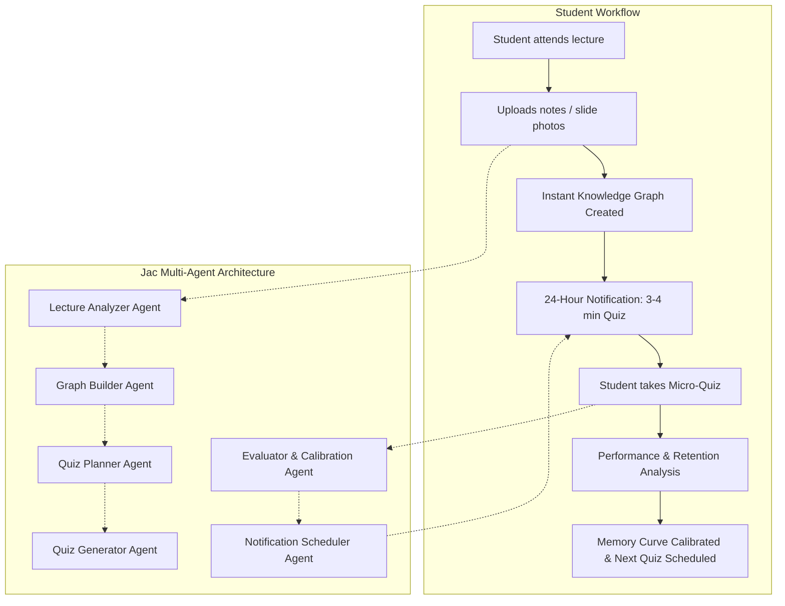
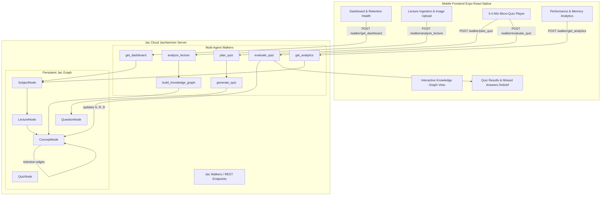

# Memora: Ebbinghaus Spaced Repetition Mobile App
> **Full Architecture, Specifications, and Team Work Distribution**  
> Powered by **Jac Platform** (`jaclang`) and hosted on **JacHammer** (`jachammer.ai`).

---

## 1. Project Goal & Overview

According to Hermann Ebbinghaus's forgetting curve, students forget approximately **50%** of newly learned lecture material within the first 24 hours. **Memora** solves this problem through timely, micro-learning interventions:

1. **Lecture Ingestion**: The student submits lecture notes, photos of lecture slides, whiteboard photos, or handwritten notes.
2. **Knowledge Graph Modeling**: A multi-agent Jac backend analyzes the content, extracts atomic concepts, maps prerequisite dependencies, and anchors them into a persistent knowledge graph.
3. **Proactive Intervention**: 24 hours later (the critical Day-1 drop), the app dispatches a notification for a **3–4 minute micro-quiz**.
4. **Active Recall & Calibration**: The student completes the quiz. The system evaluates answers, diagnoses memory gaps, and recalibrates the memory stability curve.
5. **Continuous Spaced Repetition**: Concepts missed or fading are prioritized for the next scheduled quiz, flattening the forgetting curve over time.

The rollout begins with a **single subject module** (e.g. *Computer Networks: TCP/IP & Subnetting*) and seamlessly expands to support **multiple subjects**.



---

## 2. LLM Provider Configuration (OpenRouter)

All LLM capabilities are accessed via **OpenRouter** (`https://openrouter.ai/api/v1`) using `OPENROUTER_API_KEY`:

1. **Multimodal Vision Model (Slide Photos & Handwritten Notes)**:
   - **Model ID**: `nvidia/nemotron-3.5-super-vl:free`
   - **Context Window**: 1,000,000 tokens
   - **Role**: Powers the **Lecture Analyzer Agent** to transcribe handwritten notes, inspect slide diagrams, and extract structured concepts ($0 cost).
2. **Reasoning & Planning Model (Quiz Generation & Calibration)**:
   - **Model ID**: `nvidia/nemotron-3-ultra-550b-a55b:free` (with fast fallback to `nvidia/nemotron-3-super:free`)
   - **Context Window**: 1,000,000 tokens
   - **Role**: Powers the **Quiz Planner**, **Quiz Generator**, and **Evaluator/Calibration Agents**.

---

## 3. Cognitive Forgetting Curve Mathematical Model

### 3.1 Retrievability ($R$)
$$R(t) = e^{-\frac{t}{S}}$$
- $t$: Elapsed time (in days) since the lecture or last quiz.
- $S$: Memory stability (in days), representing the half-life of recall.
- Initial lecture: $S_0 \approx 1.0\text{ day}$. At $t = 1\text{ day}$, retention drops to $e^{-1} \approx 37\% - 50\%$.

### 3.2 Post-Quiz Stability Calibration
- **Successful Recall ($Grade \ge 0.70$)**:
  $$S_{new} = S \times \left(1 + C \cdot (1 - R) \cdot D_{factor}\right) \approx S \times (1.8 \sim 2.5)$$
  Flattens the forgetting curve and lengthens the interval to the next review.
- **Struggled / Missed ($Grade < 0.70$)**:
  $$S_{new} = \max(1.0, S \times 0.5)$$
  The concept is flagged as **At-Risk** and prioritized for review in the next 24-hour cycle.

### 3.3 Spaced Repetition Milestones
- **Cycle 1 (Day 1 / 24h)**: Critical first intervention.
- **Cycle 2 (Day 3 / 72h)**: Second reinforcement.
- **Cycle 3 (Day 7)**: Consolidation.
- **Cycle 4 (Day 14 & 30)**: Long-term memory transfer.

---

## 4. Functional Requirements (Features)

- **FR-1 Multi-Modal Lecture Note Ingestion**: Supports raw text, markdown, lecture slide images, and photos of handwritten notes via `nvidia/nemotron-3.5-super-vl:free`.
- **FR-2 Automated Knowledge Graph Construction**: Extracts 4–8 atomic concepts per lecture, builds typed relationships (`depends_on`, `subconcept_of`, `relates_to`), and anchors into persistent Jac graph topology.
- **FR-3 Ebbinghaus Spaced Repetition Engine**: Continuously tracks retrievability decay ($R = e^{-t/S}$) and classifies concepts into 🟢 Strong ($R \ge 0.85$), 🟡 Fading ($0.60 \le R < 0.85$), and 🔴 Critical Drop ($R < 0.60$).
- **FR-4 Dynamic 3–4 Minute Micro-Quiz Generation**: Selects 3–5 high-priority concepts and generates grounded Multiple Choice and Active Recall questions.
- **FR-5 Quiz Evaluation & Memory Curve Calibration**: Grades student responses, recalculates stability $S$, and updates concept node mastery.
- **FR-6 Proactive Notification & Alert System**: Dispatches Day-1 (24h) alerts and provides an in-app reminder center.
- **FR-7 Knowledge Graph (Agent Substrate & Student Visual Map)**:
  - **For Agents**: Native Jac graph (`node`, `edge`, `walker`) persisting automatically from `root` without an external database.
  - **For Students**: Intuitive visual "Skill Tree" showing memory health with 1-tap concept detail popups.
- **FR-8 Modular Subject & Course Architecture**: Single module starter ("Computer Networks"), expandable to multi-module.
- **FR-9 Post-Quiz Answer Review & Explanations (Debrief)**: Immediate debrief showing score, time taken, missed questions with student vs. correct answer, and 1–2 sentence pedagogical explanations.
- **FR-10 Subject Memory & Performance Analytics**: Interactive retention curve line chart, quiz score trends, concept mastery distribution, and daily study streaks.

---

## 5. Non-Functional Requirements (NFRs)

- **NFR-1 Performance & Latency**: Quiz strictly time-boxed to 3–4 minutes; LLM generation $< 3.5\text{s}$; 60 FPS mobile graph rendering; API response $< 250\text{ms}$ for non-LLM operations.
- **NFR-2 Pedagogical Fidelity**: Grounded in Ebbinghaus mathematics; zero hallucination (questions strictly from ingested notes); constructive feedback on errors.
- **NFR-3 Usability & UX**: Maximum 2 taps to submit notes; 1 tap to start quiz from notification; high legibility; colorblind-safe badges.
- **NFR-4 Jac & JacHammer Compatibility**: 100% native Jac backend; deployment-ready for `jachammer.ai`; React Native / Expo mobile app.
- **NFR-5 Reliability & Offline Grace**: Automatic Jac graph persistence; offline caching for quiz submissions.
- **NFR-6 Security & Privacy**: `OPENROUTER_API_KEY` protected on backend; isolated per-student graph data.

---

## 6. System Architecture



---

## 7. Team Work Distribution (3 Developers)

| Developer | Role | Domain Ownership | Key Deliverables |
| :--- | :--- | :--- | :--- |
| **Dev 1** | **Frontend & Mobile UI Lead** | React Native / Expo App, UI/UX, Navigation, Charts | 1. `DashboardScreen` (Retention dial & quiz trigger)<br>2. `LectureUploadScreen` (Notes & slide photo capture)<br>3. `QuizScreen` (3–4 min quiz runner & timer)<br>4. `QuizResultsScreen` (Missed answers & explanations debrief)<br>5. `AnalyticsScreen` (Retention line chart & performance)<br>6. `KnowledgeGraphScreen` (Interactive concept skill tree)<br>7. `api.ts` client & local notifications |
| **Dev 2** | **Backend Dev A: Ingestion & Knowledge Graph Agents** | Graph Schema, OCR / Vision Parsing, Ingestion Agents | 1. `memora_graph.jac` (Subject, Lecture, Concept, Edges)<br>2. `agents/lecture_analyzer.jac` (Vision + Text concept extraction with Nemotron 3.5 Super VL)<br>3. `agents/graph_builder.jac` (Stitching concepts into persistent root graph)<br>4. Walkers: `ingest_lecture`, `get_graph_data`, `get_dashboard`<br>5. Single-module starter & multi-subject schema partitioning |
| **Dev 3** | **Backend Dev B: Cognitive Engine & Quiz Agents** | Ebbinghaus Engine, Quiz Planning, Quiz Generation, Calibration, Analytics | 1. `ebbinghaus.jac` (Mathematical decay $R=e^{-t/S}$ and stability update rules)<br>2. `agents/quiz_planner.jac` (Target concept selection for 3–4 min quiz)<br>3. `agents/quiz_generator.jac` (Grounded MCQ & active recall via Nemotron 3 Ultra)<br>4. `agents/evaluator.jac` (Semantic grading, error explanation, memory curve calibration)<br>5. `agents/scheduler.jac` (Day-1 & spaced review reminders)<br>6. `agents/analytics.jac` (Historical retention data)<br>7. Walkers: `plan_quiz`, `submit_quiz`, `get_analytics`, `get_notifications` |

### Detailed Developer Responsibilities & Milestones

#### Phase 1: Foundation & Contracts (Day 1)
- **Dev 1**: Initializes Expo TypeScript app in `mobile/`, configures theme, and builds mock navigation between screens.
- **Dev 2**: Creates `memora_graph.jac` defining nodes and relationships, tests local graph persistence from `root`.
- **Dev 3**: Implements mathematical decay formulas in `ebbinghaus.jac` and writes unit tests in `tests/test_forgetting_curve.jac`.
- **Sync Point**: Dev 1, Dev 2, and Dev 3 lock the JSON API contract for walker payloads.

#### Phase 2: Agent Implementation & Core Flows (Day 2 - 3)
- **Dev 1**: Connects `LectureUploadScreen` and `QuizScreen` to API stubs; builds 3–4 min countdown timer and answer feedback cards.
- **Dev 2**: Implements `LectureAnalyzerAgent` using `nvidia/nemotron-3.5-super-vl:free` to parse slide photos/text; implements `GraphBuilderAgent` to populate `ConceptNode`s.
- **Dev 3**: Implements `QuizPlannerAgent` (finding concepts with $R < 0.65$) and `QuizGeneratorAgent` (generating 4 questions with distractors and explanations).

#### Phase 3: Evaluation, Analytics & Debrief (Day 4)
- **Dev 1**: Implements `QuizResultsScreen` (missed question explanations) and `AnalyticsScreen` (Ebbinghaus retention curve line chart).
- **Dev 2**: Implements `get_graph_data` and `get_dashboard` walkers; integrates single-module seed ("Computer Networks").
- **Dev 3**: Implements `QuizEvaluatorAgent` (semantic grading & stability recalibration) and `AnalyticsAgent`.

#### Phase 4: Integration, Testing & JacHammer Deployment (Day 5)
- **All Devs**: End-to-end testing: Upload lecture $\to$ Graph built $\to$ 24h simulated notification $\to$ Take 3-min quiz $\to$ Review missed questions $\to$ Check analytics $\to$ Deploy to JacHammer (`jachammer.ai`).

---

## 8. Verification & Test Plan

1. **Unit Testing Retention Mathematics**:
   ```bash
   jac test tests/test_forgetting_curve.jac
   ```
2. **Integration Testing Agent Walker Chain**:
   ```bash
   jac test tests/test_agents.jac
   ```
3. **Jac Local Server Execution**:
   ```bash
   jac run main.jac
   ```
4. **Mobile Expo Runner**:
   ```bash
   cd mobile && npm install && npx expo start
   ```
